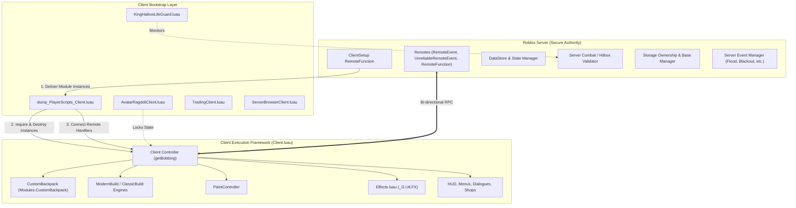
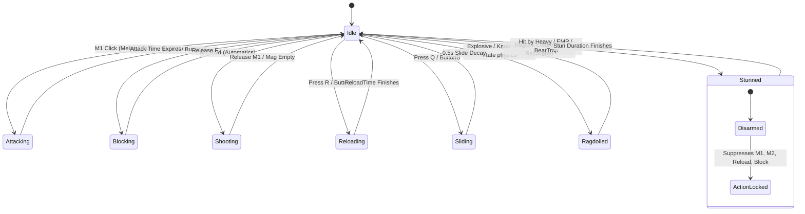
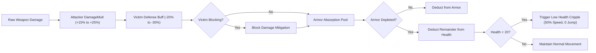
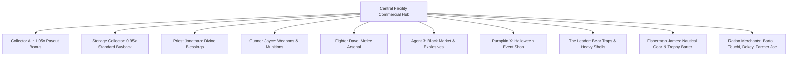
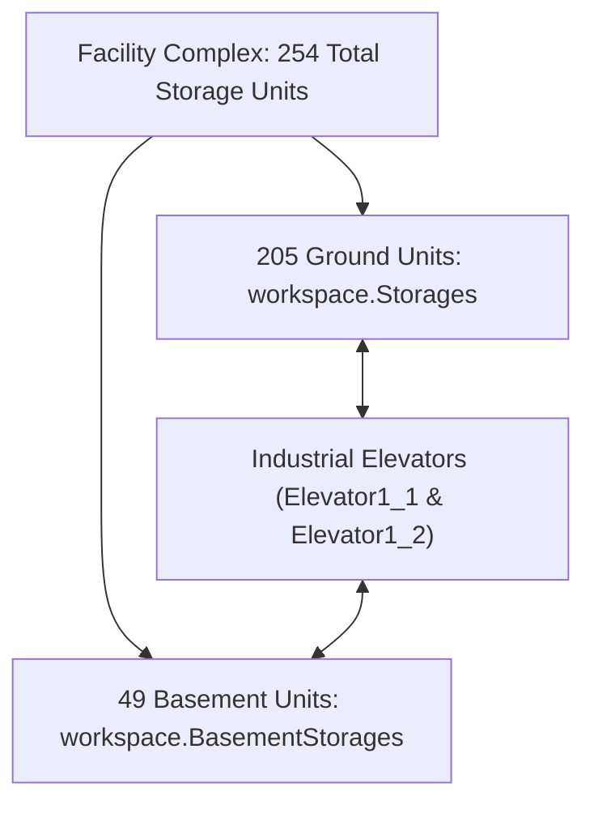
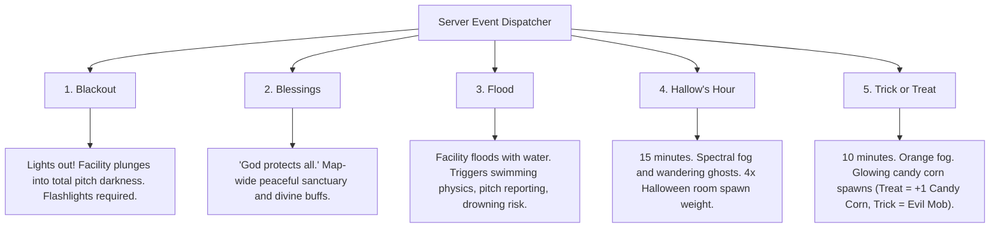
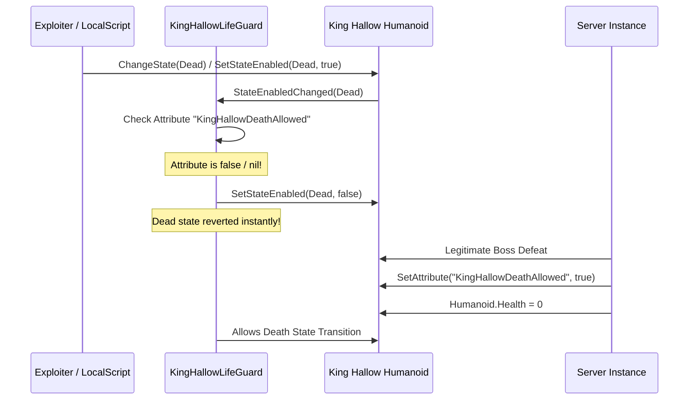
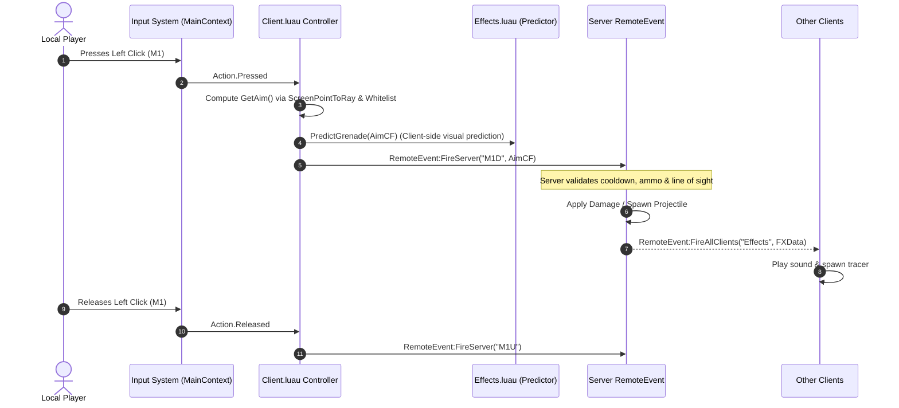
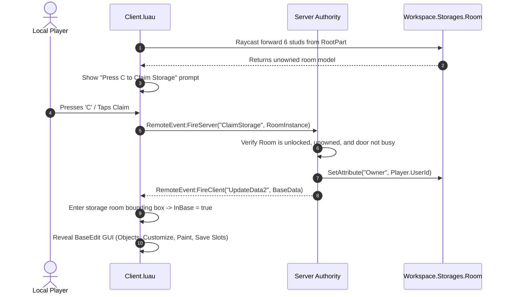

# Technical Knowledge Base & Analysis: [🎃] The Storage

## 1. Executive Summary

This document presents an exhaustive, evidence-based technical investigation into the Roblox experience **"[🎃] The Storage"** (PlaceId: `13704594433`, GameId: `4756005135`, Creator: `Khongumu` / Group `12369782`, Place Version: `2298`).

The investigation was performed by thoroughly analyzing:
1. The exported workspace archive (`Storage Workspace.zip` unpacked into `Extracted\scripts-The-Storage-BaconFrauder-20261107T063530Z`).
2. Live game DataModel reconnaissance via the `roblox-executor-mcp` bridge connected to client instance `e1afa657-3cf7-48a0-ad68-749e029969b5`.
3. Decompiled live client scripts and network remotes (`ClientSetup`, `RemoteEvent`, `UnreliableRemoteEvent`, `RemoteFunction`, `AdminPanel`, `ServerBrowserRemotes`, `TradingRemotes`).

### Summary of Major Discoveries
- **Core Loop & Genre**: An isometric/first-person multiplayer extraction survival and base-building game. Players claim abandoned storage units, construct bases using modular furniture/walls, scavenge/craft weapons, fight NPCs and other players, manage hunger/thirst/armor, participate in randomized server-wide events (Blackout, Blessings, Flood, Hallow's Hour, Trick or Treat), and store loot in personal storage vaults and banks.
- **Deep Combat & Weapon Arsenal**: Features 26 distinct weapons spanning Unarmed, Bladed/Blunt Melee, Kinetic Firearms, Incendiary/Explosive Ordnance, and Supernatural Boss Relics (`Hallow's Revolvers`, `Hallow's Saw`, `Hallow's Scythe`, `Dark Scythe`). Features poise/HyperArmor, combo chains, heavy attacks, realistic 3-axis spring recoil, and unique weapon skills.
- **PvP & Evasion Mechanics**: Features stamina-free dynamic sliding with hitbox lowering, active blocking with damage mitigation, combat-logging prevention via procedural `SafezoneGates` physical barriers, safezone PvP shield timers, and severe low-health movement cripples (< 20 HP).
- **Survival, Alchemy & Fishing**: Complete hunger/thirst metabolic decay system, stat-buffing potion/blessing alchemy (`SpeedAdd`, `DamageMult`, `Defense`), Witch's Cauldron brewing, and an in-depth fishing/marine-hunting system ranging from basic baiting to hunting apex `Megalodon` teeth.
- **Novel Code Protection**: The developers utilize an in-memory anti-tamper delivery pattern via `ReplicatedStorage.ClientSetup`. Client module references are delivered over a RemoteFunction invoke, required, and immediately destroyed from the DataModel (`v1:Destroy()`, `v2:Destroy()`) to thwart standard Explorer hierarchy dumpers.
- **Dual Building Engine**: Contains both a legacy `ClassicBuild` engine (grid-snapping, mouse raycasting) and a modern `ModernBuild` engine (subcategories, visual gizmo, direct dragging, transform hold, mobile touch handles), toggleable by user preferences.
- **Anti-Cheat & Guard Architecture**:
  - `KingHallowLifeGuard`: An active state-protection script that intercepts client attempts to kill or delete the Halloween event boss (`King Hallow`) via state manipulation (`Dead` state suppression).
  - `AvatarRagdollClient`: An active ragdoll/stun enforcer that suppresses `GettingUp`/`FallingDown` humanoid states and forces `Enum.HumanoidStateType.Physics` with `PlatformStand = true` while `Ragdolled` attribute is active.
  - `SafezoneGates`: Dynamic physical barriers that procedurally erect around safe zone entrances when a player is flagged `InCombat = true`, blocking them from entering the safezone to escape combat logging.
  - Movement speed and jump clamping: `WalkSpeed` strictly enforced at `12` (or halved when health `< 20`), and `JumpHeight` enforced at `7.2` (or `0` during slides).
  - Admin telemetry: Live player aim telemetry via `ReportAim` / `UpdateMouse` and moderator visual inspection line tool (`ShowAim` / `ModAimLines`).

---

## 2. Workspace Overview

### Directory Hierarchy
```
c:\Users\User\Desktop\Project Storage.Workspace\
├── Storage Workspace.zip                                # Original compressed workspace dump
├── Extracted\
│   └── scripts-The-Storage-BaconFrauder-20261107T063530Z\
│       ├── manifest.json                                # Dump manifest metadata & script mapping
│       ├── Client.luau                                  # Core client framework controller (14,959 lines, 494 KB)
│       ├── Utilities.luau                               # Core shared utility library (_G.Utl) (494 lines, 13 KB)
│       ├── Effects.luau                                 # Visual/Audio FX engine (_G.Utl.FX) (1,905 lines, 73 KB)
│       ├── Channel.luau                                 # Heartbeat-driven timing and debounce channel module
│       ├── Chainsaw-Rush.luau                           # Special ability FX & afterimage renderer for Chainsaw Rush
│       ├── Scythe-Slash.luau                            # Special ability FX for Scythe Slash
│       ├── VampireBite.luau                             # Special ability FX for Vampire Bite
│       ├── VampireBlur.luau                             # Screen blur and post-processing for Vampire Bite
│       ├── dump_PlayerScripts_Client.luau               # Client entry point bootstrap (1,049 lines, 35 KB)
│       ├── dump_StarterPlayer_StarterPlayerScripts_KingHallowLifeGuard.luau # Boss Anti-Kill Guard
│       ├── dump_StarterPlayer_StarterPlayerScripts_AvatarRagdollClient.luau # Ragdoll / Stun State Enforcer
│       ├── dump_StarterPlayer_StarterPlayerScripts_HallowsRevolversClient.luau # Dual Revolver energy UI/FX
│       ├── dump_StarterPlayer_StarterPlayerScripts_TradingClient.luau # Secure player-to-player trading GUI
│       ├── dump_StarterPlayer_StarterPlayerScripts_ServerBrowserClient.luau # Custom multi-server lobby browser
│       ├── dump_StarterPlayer_StarterPlayerScripts_HallowsHourClient.luau # Hallow's Hour spectral event client
│       ├── dump_StarterPlayer_StarterPlayerScripts_TrickOrTreatClient.luau # Trick or Treat candy corn event client
│       ├── dump_StarterGui_PianoGui_Main.luau           # Interactive piano instrument synthesizer client
│       ├── weapons_full_dump.json                       # Extracted JSON dump of all 26 weapons and combat attributes
│       ├── items_full_dump.json                         # Extracted JSON dump of all 107 consumables & utility items
│       ├── ReplicatedStorage\
│       │   ├── ClassicControllerSmokeFixture.luau       # QA building test mock for Classic controller
│       │   ├── ModernControllerSmokeFixture.luau        # QA building test mock for Modern controller
│       │   ├── QAAuthoredBuildingFixture.luau           # QA automated regression harness
│       │   ├── BaseObjects\
│       │   │   └── Wooden-Piano\
│       │   │       └── Settings.luau                    # Piano sound sample configurations & camera offsets
│       │   └── Modules\
│       │       ├── Achievements.luau                    # 17 in-game achievement definitions & rewards
│       │       ├── BaitsLib.luau                        # Fishing bait definitions & tiers
│       │       ├── BaseCapacityLib.luau                 # Storage unit capacity calculations
│       │       ├── BaseCustomLib.luau                   # Base architectural customization (Walls, Floors, Basements)
│       │       ├── BaseObjectsLib.luau                  # 900+ furniture and base items catalog
│       │       ├── ClassicBuild.luau                    # Legacy grid-placement construction engine
│       │       ├── ModernBuild.luau                     # Modern contextual construction engine
│       │       ├── ColorPicker/                         # Full RGB/HSV color picker suite
│       │       ├── CraftLib.luau                        # Crafting recipes and anvil/workbench formulas
│       │       ├── CustomBackpack.luau                  # Custom slot-based inventory & hotbar engine
│       │       ├── DailyRewards.luau                    # 7-day rolling daily login reward track
│       │       ├── Events.luau                          # Server environmental event configuration
│       │       ├── ExchangeLib.luau                     # Currency exchange formulas
│       │       ├── GamepassLib.luau                     # Gamepass ID mapping and ownership grants
│       │       ├── Icon/                                # TopbarPlus v2 UI library suite
│       │       ├── Lightning.luau                       # Procedural electric arc renderer
│       │       ├── PaintController.luau                 # Surface painting & coloring subsystem
│       │       ├── PartCache/                           # High-performance object pooling library
│       │       ├── ProductLib.luau                      # Developer products definition
│       │       ├── PumpkinXShopLib.luau                 # Event vendor shop items catalog
│       │       ├── PumpkinXShopUI.luau                  # Event vendor UI renderer
│       │       ├── ShopLib.luau                         # NPC vendors catalog & tooltype filters
│       │       ├── SkinsLib.luau                        # Weapon skins, rarities, and custom particle effects
│       │       ├── SpringModule.luau                    # Physics spring for recoil and camera bobbing
│       │       ├── ToolsLib.luau                        # Comprehensive weapon & tool balance statistics
│       │       ├── TradingConfig.luau                   # Trade restrictions and limits
│       │       └── UIStyleGuide.luau                    # Central UI colors, fonts, and geometry themes
│       ├── StarterPlayer\
│       │   └── StarterPlayerScripts\
│       │       ├── RbxCharacterSounds\
│       │       │   └── AtomicBinding.luau               # Roblox standard character sound binder
│       │       └── PlayerModule\                        # Roblox standard Camera & Control modules
│       └── Workspace\
│           └── Storages\Room\Contents\Objects\Wooden-Piano\
│               └── Settings.luau                        # In-world piano settings copy
```

---

## 3. Technology Stack & Dependencies

| Layer | Technology / Module | Purpose |
|---|---|---|
| **Engine** | Roblox Engine (Luau Runtime) | Core simulation, rendering, and network transport |
| **Networking** | Custom RemoteEvent / RemoteFunction / UnreliableRemoteEvent dispatch | Low-latency state sync, tick mouse updates, aim reporting, server-client RPC |
| **UI Framework** | TopbarPlus v2 (`Modules.Icon`) | Native-feeling top-bar menu icons and dropdown buttons |
| **Object Pooling** | `PartCache` (by Xavier Wild / Validark) | Fast reuse of bullet projectiles, blood splatters, and debris |
| **Math / Physics** | `SpringModule` | Recoil simulation, camera kickback, bobbing equations |
| **Procedural FX** | `Lightning.luau` | Procedural electric arcs for EMP and lightning skills |
| **Decompiler / Tools** | Velocity v1.0.3 / DEX | Workspace extraction provenance tools |
| **QA / Testing** | `QAAuthoredBuildingFixture`, `*SmokeFixture` | Developer test harnesses for regression testing building controllers |

---

## 4. Game Architecture & Core Systems

### Architectural Diagram


---

## 5. Script & Source Code Analysis

### 5.1 `dump_PlayerScripts_Client.luau` (Client Entry Bootstrap)
- **Path**: `StarterPlayer.StarterPlayerScripts.Client` (decompiled as `dump_PlayerScripts_Client.luau`)
- **Initialization Routine**:
  1. Invokes `ReplicatedStorage.ClientSetup:InvokeServer()` receiving `(v1, v2)`.
  2. Requires `v2` as `_G.Utl` and immediately calls `v2:Destroy()` to remove it from the workspace DataModel.
  3. Requires `v1` as the client controller class and immediately calls `v1:Destroy()`.
  4. Calls `v1 = v2.new(LocalPlayer)` and `v1:SetUp()`.
  5. Binds `RemoteEvent.OnClientEvent`, `UnreliableRemoteEvent.OnClientEvent`, and `RemoteFunction.OnClientInvoke` directly to member method dispatches: `v1[actionName](v1, payload)`.
  6. Spawns handshake thread requesting initial player state: `RemoteFunction:InvokeServer("GetInitialData")` with a 90-second timeout.
  7. Initializes TopbarPlus Menu button, Keybinds, Version GUI, Achievements GUI, and Settings panels.
  8. Hooks `MainContext` ContextActions for mobile, gamepad, and mouse/keyboard (M1, M2, Block, Slide, Crouch, Run, Reload, DropItem, Skills).
  9. Enforces Voice Chat presence check on dedicated VC places (`14419150323`, `14451235347`) calling `LocalPlayer:Kick("No VC Access")`.

### 5.2 `Client.luau` (Core Client Engine)
- **Class / Metatable**: `getBobbing` (instantiated via `getBobbing.new(Player)`).
- **Size & Complexity**: 14,959 lines; 493,934 bytes.
- **Key Fields**:
  - `Player`, `Camera`, `Humanoid`, `Root`, `Animator`
  - `WalkSpeed` (12), `JumpHeight` (7.2), `SlideCD` (1.75s)
  - `Data`: Player persistent state (Money, Level, EXP, Items, Bank, BaseObjects, BaseSlots, Keybinds, Skins, CandyCorn)
  - `CustomBackpack`: Instance of `CustomBackpack` module
  - `StorageBase`: Currently claimed storage room model in `workspace.Storages`
  - `EditObject`: Currently active holographic building model
  - `SafezoneGates`: Dictionary of detected collision gates in `workspace.Map["SAFEZONE GATES"]`
- **RenderStepped Loop (lines 283–750)**:
  - Constrains `WalkSpeed` to `12` (halved if `Health < 20`).
  - Constrains `JumpHeight` to `7.2` (set to `0` if sliding or injured).
  - Updates HUD coordinates (`XCoordinate`, `ZCoordinate`).
  - Evaluates underwater camera post-processing and sends pitch changes (`UnreliableRemoteEvent:FireServer("FloodPitch", Y)`).
  - Handles base perimeter detection (`workspace:GetPartBoundsInBox(BoundingBox)`) to toggle `InBase` status.
  - Updates placement coordinates for `EditObject` across Classic, Modern, and Mobile building modes.
  - Periodic aim reporting (`UnreliableRemoteEvent:FireServer("ReportAim", aimPosition)`) every 0.03 seconds.

### 5.3 `Utilities.luau` (`_G.Utl`)
- **Path**: `ReplicatedStorage.Utilities` (decompiled as `Utilities.luau`)
- **Primary Exports**:
  - `Channel`: Thread timing helper for delayed/stoppable actions.
  - `FX`: Table containing all visual/sound manifestation routines from `Effects.luau`.
  - `Raycast(params)`: Raycast wrapper supporting Whitelist/Blacklist filter lists.
  - `PlaySound(soundData)`: Dynamic spatial audio player supporting player-only routing, pitch variations, looping timeouts, and auto-cleanup.
  - `ExpCost(level)`: Leveling curve formula: `Cost = 100 + level * 50`.
  - `Roll(pool, luckModifier)`: Weighted probability lottery roller.
  - `FolderToTable(folder)` / `TableToFolder(table)`: Serialization bridge for converting Roblox value objects into Luau dictionaries and vice versa.
  - `determineIfBehind(cf1, cf2)`: Dot product direction evaluator (`dot > 0.33`).
  - `timeFormat(seconds)`: Formats timestamps into `HH:MM:SS` or `MM:SS`.

### 5.4 `Effects.luau` (Audio-Visual FX Subsystem)
- **Path**: `ReplicatedStorage.Effects` (decompiled as `Effects.luau`)
- **Features**:
  - Projectile simulation for Grenades (`PredictGrenade`, `GrenadeProjectile`, `GrenadeConfirm`, `GrenadeClear`).
  - Gun tracers (`createBullet`), muzzle flashes (`GrenadeMuzzle`), and cylinder cycling (`GrenadeRoundsSpin`).
  - Melee impact effects: Blood bursts, spark bursts, slash trails, and ground impact dust.
  - Event atmospheric effects: Fog, water level rising/falling, and lightning strikes.

---

## 6. Comprehensive Weapon Arsenal & Balance Matrix

The game implements **26 distinct weapons** defined in `ReplicatedStorage.Modules.ToolsLib`. Weapons are grouped into five distinct operational classes:

### 6.1 Master Weapon Statistical Table

| Weapon Name | Class | Damage Type | Light Dmg | Heavy Dmg | Light CD | Heavy CD | Max Combo | Stun (Light / Heavy) | Poise (HyperArmor) | Ammo Type | Reload Time | Sell Value | Special Attributes / Skills |
|---|---|---|---|---|---|---|---|---|---|---|---|---|---|
| **Fist** | Unarmed | Blunt | 7.0 | 11.0 | 0.50s | 2.50s | 4 | 0.50s / 0.85s | No | N/A | N/A | N/A | Default unarmed combat |
| **Knife** | Melee | Sharp | 9.0 | 14.0 | 0.45s | 3.00s | 4 | 0.40s / 0.50s | No | N/A | N/A | $50 | Fast recovery light blade |
| **Frying Pan** | Melee | Blunt | 10.0 | 15.0 | 0.50s | 3.00s | 4 | 0.40s / 0.50s | No | N/A | N/A | $60 | Metallic impact sounds |
| **Baseball Bat** | Melee | Blunt | 10.0 | 17.0 | 0.50s | 2.50s | 4 | 0.45s / 0.50s | No | N/A | N/A | $90 | Blunt concussive melee |
| **Metal Pipe** | Melee | Blunt | 12.0 | 20.0 | 0.50s | 2.50s | 4 | 0.45s / 0.50s | No | N/A | N/A | $125 | High base blunt damage |
| **Katana** | Melee | Sharp | 13.0 | 20.0 | 0.60s | 2.50s | 4 | 0.60s / 0.70s | No | N/A | N/A | $175 | Sharp blade with extended hitbox |
| **Fire Axe** | Melee | Sharp | 13.7 | 21.0 | 0.60s | 2.50s | 4 | 0.50s / 0.70s | No | N/A | N/A | $200 | Firefighter breaching tool |
| **Claymore** | Melee | Sharp | 14.5 | 22.0 | 0.55s | 2.50s | 4 | 0.55s / 0.70s | No | N/A | N/A | $300 | Knight two-handed sword |
| **False Trident** | Melee | Sharp | 15.0 | 24.0 | 0.55s | 2.50s | 4 | 0.55s / 0.70s | No | N/A | N/A | $500 | Skill: `Fish Chunk Barrage` |
| **Chainsaw** | Melee | Sharp | 12.5 | 20.0 | 0.60s | 2.50s | 4 | 0.60s / 0.85s | **Yes** | N/A | N/A | $300 | Continuous cutting; Unflinching |
| **Hallow's Saw** | Melee | Sharp | 16.0 | 25.0 | 0.60s | 2.50s | 4 | 0.60s / 0.85s | **Yes** | N/A | N/A | $800 | Skill: `Chainsaw Rush` |
| **Scythe** | Melee | SharpBlunt | 14.5 | 24.0 | 0.55s | 2.50s | 4 | 0.70s / 0.85s | **Yes** | N/A | N/A | $400 | Heavy sweeping reach |
| **Hallow's Scythe** | Melee | SharpBlunt | 18.0 | 30.0 | 0.55s | 2.50s | 4 | 0.70s / 0.85s | **Yes** | N/A | N/A | $1000 | Skill: `Scythe Slash` wave projectile |
| **Dark Scythe** | Melee | SharpBlunt | 25.0 | 50.0 | 0.55s | 2.50s | 3 | 0.70s / 0.85s | **Yes** | N/A | N/A | $25 | Skill: `Dimensional Slash` (Mod spec) |
| **Sledgehammer** | Melee | SharpBlunt | 30.0 | 38.0 | 0.70s | 2.00s | 2 | 0.70s / 0.85s | **Yes** | N/A | N/A | $500 | Massive single-hit damage |
| **Revolver** | Gun | Sharp | 20.0 | N/A | 0.45s | N/A | N/A | 0s | No | Light Ammo | 0.55s | $125 | Semi-automatic pistol |
| **Deagle** | Gun | Sharp | 35.0 | N/A | 0.50s | N/A | N/A | 0s | No | Medium Ammo | 0.75s | $200 | Heavy stopping power pistol |
| **SMG** | Gun | Sharp | 11.0 | N/A | **0.05s** | N/A | N/A | 0s | No | Light Ammo | 0.85s | $275 | Extreme rate of fire (20 rps) |
| **AK47** | Gun | Sharp | 15.0 | N/A | **0.10s** | N/A | N/A | 0s | No | Medium Ammo | 0.85s | $200 | Automatic rifle (10 rps) |
| **LMG** | Gun | Sharp | 13.0 | N/A | **0.05s** | N/A | N/A | 0s | No | Medium Ammo | 0.85s | $500 | High capacity squad support |
| **Shotgun** | Gun | Sharp | 9.0x4 (36) | N/A | 0.65s | N/A | N/A | 0s | No | Shotgun Ammo | 1.25s | $450 | 4 Pellets per spread |
| **Double Barrel** | Gun | Sharp | 11.0x6 (66) | N/A | 0.40s | N/A | N/A | 0s | No | Shotgun Ammo | 1.05s | $550 | 6 Pellets; Devastating burst |
| **Flamethrower** | Heavy | Sharp | 10.0 | N/A | **0.05s** | N/A | N/A | 0s | No | Fuel | 1.00s | $300 | Continuous stream; AoE burn |
| **Grenade Launcher** | Heavy | Explosive | 70.0 | N/A | 0.75s | N/A | N/A | Knockdown | No | Grenade | 1.60s | $1200 | Arcing ballistics (Speed: 200, Arc: 12) |
| **Harpoon Gun** | Tactical | Piercing | 25.0 | N/A | 10.0s | N/A | N/A | 1.00s | No | N/A | N/A | $900 | Hook shot; Pulls enemy to shooter |
| **Hallow's Revolvers** | Energy Gun | Blunt | 40.0 | 75.0 | 1.50s | 3.00s | N/A | 0.75s / 1.00s | No | Energy Gauge | 4.0s (Auto) | Event | Dual Cero beam blasters |

---

### 6.2 Gun Recoil Physics Parameters
Firearms integrate with `SpringModule.luau` to induce screen kickback across three procedural axes:

$$\text{Kick} = \frac{1}{\text{modifier}} \begin{pmatrix} \text{Up}_1 + \text{rand}() \cdot \text{Up}_2 \\ \text{Side}_1 + \text{rand}() \cdot \text{Side}_2 \\ \text{Shake}_1 + \text{rand}() \cdot \text{Shake}_2 \end{pmatrix}$$

| Weapon | Up Vector `[Min, Max]` | Side Vector `[Min, Max]` | Shake Vector `[Min, Max]` | Recoil Characteristic |
|---|---|---|---|---|
| **Revolver** | `[0.15, 0.30]` | `[-0.40, 0.80]` | `[1.50, 3.00]` | Snappy vertical jump |
| **Deagle** | `[0.20, 0.50]` | `[-0.50, 1.00]` | `[1.60, 3.50]` | Violent single-shot kick |
| **SMG** | `[0.15, 0.17]` | `[-0.25, 0.50]` | `[1.00, 2.00]` | High-frequency horizontal wobble |
| **AK47** | `[0.30, 0.50]` | `[-0.50, 1.00]` | `[2.00, 4.50]` | Heavy rotational muzzle climb |
| **LMG** | `[0.10, 0.20]` | `[-0.20, 0.50]` | `[1.50, 3.00]` | Sustained moderate jitter |
| **Shotgun** | `[2.50, 1.50]` | `[-2.50, 5.00]` | `[5.00, 5.00]` | Massive concussive punch |
| **Double Barrel** | `[2.50, 1.75]` | `[-2.75, 5.50]` | `[5.00, 6.50]` | Extreme screen disorientation |
| **Flamethrower** | `[0.10, 0.10]` | `[-0.20, 0.30]` | `[1.00, 1.50]` | Minimal steady vibration |

---

### 6.3 Mythical & Special Weapon Deep-Dive

#### 1. Hallow's Revolvers (Energy Mechanics & Cero Beam)
- **Source**: `dump_StarterPlayer_StarterPlayerScripts_HallowsRevolversClient.luau`.
- **Operating Principle**: Does not consume physical ammo items. Employs a local 100-point Energy Gauge (`HallowsRevolversEnergy` ScreenGui).
- **Attacks**:
  - **M1 (Light)**: Rapid dual-barrel energy bolts dealing 40 damage. Consumes 15 Energy.
  - **M2 (Heavy Charged Beam)**: Holding M2 charges a massive blue Cero ray (`RevolverHeavyCharge` sound ID `rbxassetid://72489278445121`). Releasing fires the beam dealing **75 Heavy Damage** and **1.0 second stun**. Requires 60 Energy.
- **Recharge Mechanism**: Recharging commences automatically after remaining idle without firing for **4.0 seconds**. Screen flash effect is rendered via `ShotFlash` cyan overlay (`Color3.fromRGB(112, 221, 255)`).

#### 2. Hallow's Saw (`Chainsaw-Rush.luau`)
- **Soul Weapon**: Crafted using King Hallow's Soul.
- **Poise & HyperArmor**: `HyperArmor = true` prevents the attacker from being staggered or flinched by enemy light attacks during revving.
- **Special Skill (`Chainsaw Rush`)**:
  - **Charge Phase**: Player is enveloped in a cyan silhouette highlight (`ChainsawRushCharge`, `DepthMode = Occluded`, `Color3.fromRGB(125, 225, 255)`).
  - **Rush Phase**: The character surges forward at high velocity. Every 0.03 seconds, `stamp()` creates a frozen physical afterimage model (`ChainsawRushAfterimage`) cloning all character body parts with neon material, stripped textures, and glowing cyan highlights that fade over 0.4 seconds via `TweenService`.
  - **Impact**: Multi-hitbox slicing on all collided entities along the rush path. Can be cancelled prematurely if stunned or ragdolled.

#### 3. Hallow's Scythe (`Scythe-Slash.luau`)
- **Boss Relic**: Crafted from King Hallow's crown and scythe.
- **Poise**: Possesses HyperArmor on all swings.
- **Special Skill (`Scythe Slash`)**:
  - Pressing the skill key spawns a physical crescent wave projectile `Objects.ScytheSlash` offset 2 studs in front of the caster.
  - Fires the `Slash2` sound (`Speed = 1.25 + rand * 0.1`) and bursts particle emitters configured with the `EmitCount` attribute.
  - The slash travels outward in a straight line, cleaving through multiple targets before being cleaned up by `game.Debris:AddItem(clone, 1.5)`.

#### 4. Grenade Launcher (`Effects.luau`)
- **Ballistics Engine**: Fires real grenades loaded from inventory.
- **Physics Equations**:
  $$\vec{v}_0 = \text{aimDirection} \cdot \text{Speed} (200) + \begin{pmatrix} 0 \\ \text{Arc} (12) \\ 0 \end{pmatrix} + \vec{v}_{\text{character}}$$
- Heartbeat integration computes gravity:
  $$\vec{v}_{t+\Delta t} = \vec{v}_t + \begin{pmatrix} 0 \\ -g \cdot \Delta t \\ 0 \end{pmatrix}, \quad \vec{p}_{t+\Delta t} = \vec{p}_t + \vec{v} \cdot \Delta t$$
- Direct impacts on humanoids trigger instant detonation dealing **70 explosive damage** and ragdoll knockdowns.

#### 5. Harpoon Gun
- Tactical crowd-control weapon with a **10.0s cooldown**.
- On contact with an enemy player or NPC, deals **25 piercing damage**, inflicts **1.0 second stun**, and forcibly pulls the victim to the shooter's position, setting up melee combos or trap ambushes.

---

## 7. In-Depth PvP & Combat Systems

### 7.1 Combat State Machine
A player's combat state is governed by a set of mutually exclusive and overlapping character attributes:


### 7.2 Damage Mitigation Pipeline
When a character takes damage, the final health deduction is computed through a tiered mitigation pipeline:

$$\text{Effective Damage} = \text{Incoming Damage} \cdot (1 - \text{Defense}) \cdot (1 - \text{BlockReduction})$$



1. **Attacker Multipliers (`DamageMult`)**: Active potion/blessing buffs increase outgoing damage (`Chaos Potion` +25%, `The Stuff` +20%, `Super Human Blessing` +15%).
2. **Victim Defense Multipliers (`Defense`)**: Active defense buffs mitigate incoming damage (`Defense Blessing` -30%, `Super Human Blessing` -20%).
3. **Active Blocking**: Holding `Block` mitigates incoming damage and prevents headshot/crit bonuses. If hit by heavy attacks exceeding guard break thresholds, block is broken and attacker inflicts full `HeavyStun`.
4. **Armor Pool Absorption**: Armor pads provide up to **100 Armor**. Incoming damage depletes the Armor meter before health is reduced.
5. **Low Health Cripple Threshold**: When Health drops below **20 HP**:
   - `WalkSpeed` is immediately halved from `12` to `6` studs/second.
   - `JumpHeight` is reduced from `7.2` to `0` (jump disabled).
   - Character enters an injured limp, making disengagement without sliding or teammate support difficult.

### 7.3 Movement Tech: The Combat Slide
- **Execution**: Triggered via `MainContext.Slide` (`Q` key on Keyboard / `ButtonB` on Controller).
- **Requirements**:
  - Downward ground raycast check: `_G.Utl.Raycast({ Origin = Root.Position, Dir = Root.CFrame.upVector * -3.5 })`.
  - Cooldown: **1.75 seconds** (`SlideCD`).
  - Not currently fishing and Health >= 20.
- **Physics Curve**:
  - Sets `Sliding = true` and `JumpHeight = 0`.
  - Creates a `BodyVelocity` with `MaxForce = Vector3.new(1e7, 0, 1e7)`.
  - Initial Velocity: $\text{Root.CFrame.LookVector} \cdot (\text{WalkSpeed} \cdot 2) = 24 \text{ studs/sec}$.
  - Loops across 10 steps of 0.05 seconds: velocity decays by multiplying by **0.97** per tick, and `MaxForce` decays by **0.95**.
  - Camera drops by -1.5 studs (`UDim2.new(0, -1.5, 0.25)`), lowering player hitbox profile beneath incoming gunfire and high melee swings.
  - Temporarily disables `HumanoidStateType.GettingUp` and `FallingDown` to prevent tripping on terrain.

### 7.4 Combat Logging Prevention & Safezone Lockout
- **In-Combat Status**: Damaging another player or receiving damage applies the `InCombat` flag and displays the `HUD.InCombat` warning banner.
- **Safezone Lockout (`SafezoneGates`)**:
  - When `InCombat == true`, the client checks if the player is outside the safezone perimeter bounding box (`workspace.Map.SafezoneDetect`).
  - The physical gate parts (`SZGATE`) located in `workspace.Map["SAFEZONE GATES"]` procedurally grow upward to their full height (`gate.Size.Y * alpha`) at a rate of `dt * 8`.
  - `SZGATE.CanCollide` is set to `true`, physically locking out the combatant and preventing them from retreating into safety while tagged.
- **Safezone Shield (`PVPShield`)**:
  - Exiting the safezone grants a temporary countdown shield (`PVPShield` attribute) during which PvP damage is disabled.
  - Players can choose to prematurely dismiss the shield by pressing the `HUD.PVPShield.Button` ("Dismiss Shield" -> `RemoteEvent:FireServer("PVPShieldOff")`) to immediately engage in combat.

---

## 8. Core Survival & Environmental Game Mechanics

### 8.1 Metabolic Cycle: Hunger & Thirst

Players must manage two continuous metabolic bars that deplete over time:

```
[Hunger: 0 - 100%]  --->  Restored via Food items
[Thirst: 0 - 100%]  --->  Restored via Drinks & Potions
```

#### Consumables & Nutritional Values Table

| Item Name | Item Type | Hunger Restored | Thirst Restored | Health Restored | Buff Duration | Special Status / Stat Buff | Sell Value |
|---|---|---|---|---|---|---|---|
| **Apple** | Food | +5 | +2 | +5 | N/A | Basic forageable fruit | $2 |
| **Banana** | Food | +7 | 0 | +5 | N/A | Basic forageable fruit | $2 |
| **Chocolate Bar** | Food | +8 | 0 | +2 | N/A | Trade item | $5 |
| **Fried Chicken** | Food | +15 | 0 | +7 | N/A | Fast food | $8 |
| **Burger** | Food | +20 | 0 | +5 | N/A | High hunger replenishment | $8 |
| **Pizza** | Food | +20 | 0 | +5 | N/A | Standard cooked slice | $2 |
| **Storage Flakes** | Food | +20 | 0 | +15 | N/A | Cereal box | $14 |
| **Waffles** | Food | +20 | 0 | +15 | N/A | Last waffle brand | $15 |
| **Prangles** | Food | +20 | 0 | +8 | N/A | Potato chips can | $50 |
| **Canned Chicken** | Food | +34 | 0 | +10 | N/A | Durable protein can | $35 |
| **Canned Peaches**| Food | +30 | +15 | +15 | N/A | Hydrating fruit preserve | $50 |
| **Ramen** | Food | **+50** | **+40** | **+33** | N/A | Elite combined meal | $100 |
| **Water Bottle** | Drink | 0 | **+40** | +3 | N/A | Clean hydration | $8 |
| **Soda** | Drink | +2 | +15 | +4 | N/A | Sugary carbonated beverage | $15 |
| **Milk** | Drink | +10 | +20 | +8 | N/A | Calcium beverage | $18 |
| **Failed Potion** | Potion | 0 | +25 | +5 | N/A | Failed brew result | $8 |
| **Medkit** | Medical | 0 | 0 | **+50** | N/A | Major medical healing | $50 |
| **Armor Pad** | Armor | 0 | 0 | 0 (Armor +30) | N/A | Replenishes Armor bar | $25 |

---

### 8.2 Alchemy, Blessings & Potions

Potions and Holy Cross Blessings provide temporary buffs modifying three core character traits:
- `SpeedAdd`: Flat increase added to `WalkSpeed`.
- `DamageMult`: Percentage multiplier added to outgoing damage.
- `Defense`: Percentage reduction subtracted from incoming damage.

| Alchemical Item | Category | Duration | Speed Buff (`SpeedAdd`) | Damage Buff (`DamageMult`) | Defense Buff (`Defense`) | Instant Health | Sell Value | Notes / Description |
|---|---|---|---|---|---|---|---|---|
| **Health Blessing** | Cross | Instant | 0 | 0 | 0 | **+100 HP** | $200 | Instant full health restoration |
| **Speed Blessing** | Cross | 120s | **+5** | 0 | 0 | 0 | $270 | WalkSpeed increases to 17 |
| **Defense Blessing**| Cross | 120s | 0 | 0 | **+30%** | 0 | $300 | 30% all-source damage reduction |
| **Super Human Blessing** | Cross | **180s** | **+5** | **+15%** | **+20%** | 0 | $400 | Tri-buff god elixir |
| **The Stuff** | Chemical | 120s | **+3** | **+20%** | 0 | 0 (Hunger +5) | $300 | High damage combat stimulant |
| **Chaos Potion** | Potion | **300s** | 0 | **+25%** | 0 | 0 (Thirst +20) | $250 | Highest damage booster in game |
| **Speed Juice** | Drink | 120s | **+5** | 0 | 0 | +1 (Thirst +10) | $100 | Budget speed drink |

#### Witch's Cauldron Brewing Mechanics
- Placeable base furniture (`Witch's Cauldron`).
- Players interact with the cauldron to open `HUD.Brewing`.
- Dropping ingredients (`RemoteEvent:FireServer("BrewIngredient")`) triggers bubbling particle effects (`Sound = "Bubbles"`), animates the tool descending into the cauldron, and rolls recipes to produce specialized potions or `Failed Potion`.

---

### 8.3 Fishing & Deep-Sea Monster Hunting

Players can fish in designated water bodies using rods and bait:
- **Rods**: `Basic Rod` (Sell: $50).
- **Baits (`BaitsLib.luau`)**: `Worm` provides **1.01x Luck** and **1.1x Reel Speed**.
- **Probability Lottery (`_G.Utl.Roll`)**: Evaluates weighted pools to catch fish:

| Catch Name | Category | Rarity Tier | Sell Price | Description / Commercial Use |
|---|---|---|---|---|
| **Shrimp** | Fish | Common | $8 | Common small crustacean |
| **Salmon** | Fish | Common | $10 | Common market fish |
| **Yellowfin Tuna** | Fish | Common | $22 | Standard commercial fish |
| **Trout** | Fish | Uncommon | $25 | River delicacy |
| **Amberjack** | Fish | Rare | $90 | High-value sport fish |
| **Pufferfish** | Fish | Rare | $120 | Dangerous poisonous delicacy |
| **Sea Urchin** | Fish | Rare | $150 | Spikey delicacy |
| **Bluefin Tuna** | Fish | Epic | $400 | Highly prized by Sushi Chef Nori |
| **Crystal Fish** | Fish | **Legendary** | **$999** | Rarest catch in the ocean |
| **Shark Tooth** | Trophy | Rare | $60 | Harvested from predatory sharks |
| **Megalodon Tooth** | Trophy | **Mythic** | **$1250** | Giant prehistoric apex predator tooth |

---

### 8.4 Tactical Traps & Ordnance

1. **Bear Trap (`Bear Trap`)**:
   - Item placed onto floors in doorways or corridors.
   - When stepped on by an enemy player or NPC, snaps shut dealing damage and inflicting complete immobilization/stun.
2. **Standard Hand Grenade (`Grenade`)**:
   - Thrown via `Effects.PredictGrenade`.
   - 3.0 second fuse. Bounces off walls/surfaces before detonating in a high-damage shrapnel blast.
3. **EMP Grenade (`EMP Grenade`)**:
   - High-tech tactical grenade.
   - Generates an electric shockwave (rendered via `Lightning.luau`) that immediately disables electronic traps, scrambles HUD elements, and stuns combatants in radius.

---

### 8.5 Crafting Matrix & Anvil Upgrades (`CraftLib.luau`)

Players refine raw ores mined with `Pickaxe` into ingots and combine components to craft weapons and supernatural arms:

```
[Silver / Gold / Diamond / Iron Ores]  ---> Refined into Bars / Components
[Weapons + Hallow's Crown + Ectoplasm] ---> Upgraded into King Hallow Boss Weapons
```

| Output Item | Recipe Ingredients Required | Cash Cost | Level Req | Category |
|---|---|---|---|---|
| **Armor Pad** | Silver Ore (x1) + Components (x1) | $0 | 0 | Armor |
| **Light Ammo Pack** (x50) | Light Ammo (x50) | $5 | 0 | Ammo Pack |
| **Medium Ammo Pack** (x50) | Medium Ammo (x50) | $5 | 0 | Ammo Pack |
| **Shotgun Ammo Pack** (x50) | Shotgun Ammo (x50) | $5 | 0 | Ammo Pack |
| **LMG** | SMG (x1) + Components (x15) + Wrench (x2) | $250 | 15 | Heavy Firearm |
| **Turret** | LMG (x4) + Components (x15) + Wrench (x10) | $5000 | 25 | Base Defense |
| **Grenade** | Coal Ore (x5) + Components (x6) | $100 | 15 | Explosive Ordnance |
| **Diamond** | Diamond Ore (x2) | $0 | 0 | Refined Gem |
| **Silver Bar** | Silver Ore (x2) | $0 | 0 | Refined Ingot |
| **Gold Bar** | Gold Ore (x2) | $0 | 0 | Refined Ingot |
| **Components** | Iron Ore (x2) + Bronze Ore (x3) | $0 | 0 | Crafting Material |
| **Wrench** | Silver Ore (x2) + Bronze Ore (x3) | $0 | 0 | Utility Tool |
| **Crowbar** | Silver Ore (x5) + Bronze Ore (x5) | $0 | 0 | Breaching Tool |
| **Hallow's Revolvers** | Revolver (x2) + Hallow's Crown (x2) + Ectoplasm (x100) | $1000 | 0 | Boss Relic Gun |
| **Hallow's Saw** | Chainsaw (x1) + Hallow's Crown (x1) + Ectoplasm (x50) | $500 | 0 | Boss Relic Melee |
| **Hallow's Scythe** | Scythe (x1) + Hallow's Crown (x1) + Vampire Cape Tatters (x20) | $500 | 0 | Boss Relic Melee |

---

### 8.6 NPC Commercial Hubs & Vendor Economy Matrix (`ShopLib.luau`)

The facility hosts a network of 13 interactive NPC merchants distributed throughout safe zones and specialized sectors. Each vendor maintains strict stock quotas, minimum level thresholds, and distinct buying/selling margins:



#### Detailed Merchant Inventory & Pricing Directory

| Vendor Name | Stocked Item / Service | Buy Price | Purchase Limit | Level Req | Category / Notes |
|---|---|---|---|---|---|
| **Collector Ali** | General Buyback | **+5% Bonus (1.05x)** | Unlimited | 0 | Buys Loot, Keys, Fish, Food, Items, Teeth |
| **Storage Collector** | General Buyback | Standard (0.95x) | Unlimited | 0 | Buys Loot, Keys, Fish, Food, Items, Teeth |
| **Weapon Collector Neil**| Weapon Buyback | Standard | Unlimited | 0 | Dedicated arms merchant buyback |
| **Priest Jonathan** | Health Blessing | $1,000 | 3 | 10 | Instant 100 HP restoration |
| | Speed Blessing | $1,000 | 2 | 10 | +5 WalkSpeed for 120s |
| | Defense Blessing | $1,250 | 2 | 15 | +30% Damage resistance for 120s |
| | Super Human Blessing| $2,000 | 1 | 20 | God elixir: +5 Speed, +15% Dmg, +20% Def |
| **Gunner Jayce** | Revolver | $600 | 4 | 0 | Kinetic sidearm |
| | AK47 | $1,750 | 2 | 5 | Automatic assault rifle |
| | SMG | $2,300 | 1 | 15 | Rapid-fire automatic |
| | Light Ammo (x1) / Pack (x50)| $5 / $225 | 20 / 8 | 3 | Pistol/SMG ammunition |
| | Medium Ammo (x1) / Pack (x50)| $8 / $400 | 20 / 5 | 5 | Assault rifle ammunition |
| | Armor Pad | $100 | 20 | 5 | Protective vest replenishment |
| **Fighter Dave** | Knife | $450 | 1 | 0 | Fast starter melee |
| | Baseball Bat | $700 | 1 | 0 | Blunt combo melee |
| | Katana | $1,250 | 1 | 7 | High bleed slashing weapon |
| | Fire Axe | $1,400 | 1 | 10 | Heavy poise breaker |
| **Agent 3** | Crowbar | $500 | 5 | 10 | High structure damage tool |
| | Grenade | $2,000 | 2 | 15 | Frag explosive (70 dmg) |
| | EMP Grenade | $1,250 | 3 | 15 | Screen-distorting electronic disruptor |
| **The Leader** | Shotgun Ammo (x1) / Pack (x50)| $24 / $1,000 | 15 / 4 | 8 | Buckshot ammunition |
| | Bear Trap | $2,000 | 3 | 15 | Lethal immobilizing ground hazard |
| | Armor Pad | $90 | 15 | 0 | Discounted body armor |
| **King Brian** | King's Crown | $350 | 1 | 5 | Royal headwear accessory |
| | Claymore | $1,500 | 3 | 10 | Massive two-handed greatsword |
| **Coleman** | "The Stuff" | $750 | 8 | 8 | Combat stimulant (+3 Speed, +20% Dmg) |
| **Miner Robert** | Pickaxe | $500 | 3 | 0 | Ore extraction tool |
| **Fisherman James** | Basic Rod | $750 | 1 | 0 | Fishing rod |
| | Worm Bait | $50 | 5 | 0 | 1.01x Luck, 1.1x Reel speed bait |
| **Sushi Chef Nori** | Fish Buyback | Market Value | Unlimited | 0 | Specialized seafood buyer |
| **Bartoli** | Pizza | $50 | 8 | 10 | +30 Hunger, +10 Thirst |
| **Teuchi** | Ramen | $450 | 4 | 10 | +100 Hunger, +25 Thirst |
| **Dokey** | Water Bottle | $35 | 5 | 0 | +40 Thirst |
| | Canned Chicken | $80 | 2 | 0 | +50 Hunger |
| | Canned Peaches | $120 | 2 | 5 | +45 Hunger, +20 Thirst |
| **Farmer Joe** | Apple / Banana | $10 | 5 | 0 | +15 Hunger, +5 Thirst starter food |

---

### 8.7 Storage Real Estate & Underground Facility Architecture

The map is structured around personal storage units that serve as claimable bases, fortified bunkers, and loot vaults.



#### Unit Specifications & Real Estate Mechanics
- **Ground Floor Capacity**: 205 storage units (`Room` models in `workspace.Storages`).
- **Basement Complex**: 49 underground vault rooms (`BasementRoom` models in `workspace.BasementStorages`).
- **Industrial Transit Elevators**:
  - `Elevator1_1`: Positioned at `(695.7, 7, -0.45)`.
  - `Elevator1_2`: Positioned at `(-693.7, 7, -0.45)`.
  - Seamlessly transports players between the main level and the underground bunker complex.
- **Unit Attributes & Lifecycle**:
  - `Owner`: Player username string or nil if unclaimed.
  - `Opened`: Boolean controlling motorized roller-shutter door state.
  - `BaseLightsEnabled`: Boolean governing interior lighting circuits.
  - `DoorColorHex`: Hex string for custom exterior shutter paint.
  - `BaseUnitSize`: Default `1`; expandable up to `3` adjacent units via Gamepass `1952937460` (3 Storage Unit Base).
  - `UnclaimAvailableAt`: Epoch timestamp enforcing tenancy leases. When players disconnect or abandon units, a lease countdown prevents immediate squatter claims.

---

### 8.8 Automated Base Defenses & Sentry Turrets

To protect stored loot from enemy raids and trespassers, players can construct and deploy automated sentry guns:

- **Turret Specifications**:
  - **Crafting Recipe**: `4x LMG` + `15x Components` + `10x Wrench`.
  - **Level Requirement**: Level 25.
  - **Installation Cost**: $5,000 Cash.
- **Automated Target Acquisition**:
  - Scans a 360-degree radius within the owner's unit.
  - Automatically locks onto non-whitelisted players entering the unit perimeter.
  - Fires rapid ballistic rounds using the LMG fire rate (600 RPM) and projectile ballistics.
- **Turret Customization**:
  - Supports cosmetic visual housing finishes: `Painted Blue`, `Painted Yellow`, `Painted Green`, `Painted Orange`, `Painted Purple`, `Painted Red`, `Painted Pink`, `Green Sentry`, `Pink Sentry`, and `Red Sentry`.

---

### 8.9 Weapon Skins, Gacha Crates & Bullet Tracer FX Engine (`SkinsLib.luau`)

The cosmetic engine provides weapon weapon finishes, bespoke melee animations, and custom projectile tracer visualizers:

#### Rarity Tiers & Liquidation Values
- **Common**: $100 sellback (`Painted Yellow/Orange/Purple/Red/Pink/Blue/Green`, `Damaged`, `Earth`, `Banana`, `Khongumu`).
- **Rare**: $1,000 sellback (`Checkered`, `Grey Camo`, `Rainbow`, `Purple Vibe`, `Rusted Red`, `Green Camo`, `Orange Crush`, `Green/Pink/Red Sentry`).
- **Epic**: $10,000 sellback (`Hot Pink`, `Red Spider`, `Agent`, `Fallen Agent`, `Royal`, `Heart`).
- **Legendary**: $50,000 sellback (`Menace`, `Flame`, `Black Spider`, `Glacier`, `Nebula`, `Golden`, `Crimson Red`, `Danger`, `Meow`, `Halloween 2023/2026`, `Summer 2026`).

#### Custom Projectile Particle Trails
Equipping specific legendary firearm skins dynamically binds custom particle trails to fired bullets in `Effects.luau`:
- `FlameBullet`: Blazing orange fire trails and cinder sparks.
- `GlacierBullet`: Crystalline ice trails with frost mist.
- `NebulaBullet`: Deep space cosmic purple/cyan energy wisps.
- `GoldenBullet`: Gleaming metallic golden rays.
- `MeowBullet`: Playful feline pawprint emitters with custom audio squeaks.
- `CrimsonBullet`: Blood-red energetic plasma tracers.
- `BlackSpiderBullet`: Venomous web wisps and dark matter filaments.

#### Bespoke Melee Animation Folders
High-tier Karambits and Tantos override default knife animations with custom spinning, twirling, and thrust animations via dedicated `AnimFolder` instances:
- `Danger Karambit` (Pack ID: `1647311433`)
- `Mystic Karambit`
- `Pumpkin Karambit` (Halloween Event exclusive)
- `Banana Karambit`
- `Neon Karambit`
- `Verdant Karambit`
- `Pink Tanto`

---

### 8.10 Daily Rewards & Trophy Barter Exchange System

#### 7-Day Daily Login Streak Schedule (`DailyRewards.luau`)
Players maintaining consecutive daily logins progress through a repeating 7-day reward ladder:
- **Day 1**: $500 Cash
- **Day 2**: 3x Armor Pad
- **Day 3**: 1x Speed Blessing
- **Day 4**: $2,000 Cash
- **Day 5**: 1x Super Human Blessing
- **Day 6**: 1x Medium Ammo Pack + 1x AK47
- **Day 7**: **$5,000 Cash** + **1x Premium Gacha Roll (`PremRoll`)**

#### Deep-Sea Marine Trophy Barter (`ExchangeLib.luau`)
In addition to standard currency transactions, Fisherman James operates a specialized trophy barter exchange:
- **Beach Chair (Base Object)**: Unlocked by exchanging **50x Shark Teeth**.
- **Megalodon Knife (Legendary Melee)**: Crafted by exchanging **15x Megalodon Teeth** (harvested from rare deep-sea fishing lottery rolls).

---

### 8.11 Dynamic Environmental World Events (`Events.luau`)

The server triggers five global environmental events that dynamically alter game rules:



1. **Blackout**:
   - `Icon`: `rbxassetid://108278305876045`
   - All facility lighting is extinguished. Ambient lighting drops to zero. Players without `Flashlight` are blinded, making ambushes and stealth attacks effective.
2. **Blessings**:
   - `Icon`: `rbxassetid://138887534283484`
   - Description: *"God protects all. God loves all."*
   - Golden hue stroke (`Color3.fromRGB(220, 199, 91)`). Atmospheric peaceful event providing divine blessings and safety across the map.
3. **Flood**:
   - `Icon`: `rbxassetid://122429550958966`
   - Description: *"The storage is flooding!"*
   - Blue ambient stroke. Water levels rise through the storage corridors.
   - Activates `UnderwaterCC` (Brightness -0.05, Contrast -0.1, Saturation -0.2, Tint `Color3.fromRGB(125, 180, 218)`) and `UnderwaterBlur` (Size 8).
   - Constantly fires vertical look vector pitch updates (`UnreliableRemoteEvent:FireServer("FloodPitch", Y)`) to govern swimming orientation and drowning checks.
4. **Hallow's Hour**:
   - `Icon`: `rbxassetid://120307758299679`
   - Duration: **15 minutes**.
   - Description: *"Spectral fog and wandering ghosts haunt the storage for 15 minutes. Halloween rooms have 4x selection weight."*
   - Spawns four wandering ghost particle volumes (`dump_StarterPlayer_StarterPlayerScripts_HallowsHourClient.luau`) centered around the player's root part. Halloween themed storage units spawn with **4x selection probability**.
5. **Trick or Treat**:
   - `Icon`: `rbxassetid://88593657959347`
   - Duration: **10 minutes**.
   - Description: *"Orange fog fills the storage for 10 minutes. Find glowing candy corn: treats award 1 Candy Corn, but tricks wake an Evil Candy Corn!"*
   - Managed by `dump_StarterPlayer_StarterPlayerScripts_TrickOrTreatClient.luau`. Spawns glowing interactive candy corn models throughout the hallways. Interacting evaluates a risk check: treats reward event currency `CandyCorn` (spendable at `Pumpkin X Shop`), while tricks instantly awaken hostile `Evil Candy Corn` NPCs that attack the player.

---

### 8.12 Achievement & Quest Progression System (`Achievements.luau`)

The game features 17 persistent achievements tracked in `ReplicatedStorage.Modules.Achievements`. Completing these tasks rewards substantial Cash, EXP, and exclusive Legendary weapon skin packs:

| Achievement Name | Task Description | Goal Metric | Cash Reward | EXP Reward | Special Cosmetic Reward |
|---|---|---|---|---|---|
| **First Timer** | Die for the first time in the facility | 1 Death | $1 | 1 EXP | — |
| **Explorer** | Open 100 storage units across the map | 100 Storages | $500 | 750 EXP | — |
| **Fighter** | Collect your first weapon | 1 Weapon | $50 | 100 EXP | — |
| **Slayer** | Defeat 30 hostile NPCs | 30 NPCs | $1,500 | 900 EXP | — |
| **Player Slayer** | Defeat 25 rival players in PvP combat | 25 Players | $1,000 | 1,000 EXP | — |
| **Squad 5** | Meet Squad 5 (Talk to NPC The Leader) | 1 Interaction | $200 | 80 EXP | — |
| **Wealthy** | Accumulate $50,000 in personal balance | $50,000 | $0 | 4,500 EXP | — |
| **Generous** | Donate $1,000 to the facility pool | $1,000 Donated | $0 | 2,500 EXP | — |
| **Builder** | Place 25 base objects inside claimed storage | 25 Objects | $800 | 500 EXP | — |
| **Agent Slayer** | Defeat 5 Syndicate Agents | 5 Agents | $5,000 | 3,000 EXP | — |
| **Survivor** | Survive in facility for 1 continuous hour (base time excluded) | 3,600 Seconds | $3,500 | 1,500 EXP | — |
| **Most Wanted** | Accumulate a $5,000 bounty on your head | $5,000 Bounty | $15,000 | 2,500 EXP | — |
| **Green Thumb** | Recycle 2,500 empty water/drink bottles | 2,500 Bottles | $0 | 0 EXP | **Legendary Skin: "Green Thumb"** |
| **Menace** | Defeat 1,000 rival players in PvP combat | 1,000 Players | $0 | 0 EXP | **Legendary Skin: "Menace"** |
| **Nebula Warrior**| Defeat 400 Extraterrestrial Aliens | 400 Aliens | $0 | 0 EXP | **Legendary Skin: "Nebula"** |
| **Fireborn** | Defeat 200 Flamethrower Pyro NPCs | 200 Pyro NPCs | $0 | 0 EXP | **Legendary Skin: "Flame"** |
| **Millionaire** | Hold $1,000,000 in your wallet at one time | $1,000,000 | $0 | 10,000 EXP | — |

---

### 8.13 Secure Peer-to-Peer Trading Architecture (`TradingClient.luau`)

Player-to-player trade operations are mediated through a state machine preventing bait-and-switch scams, item cloning, and race conditions:

```mermaid
sequenceDiagram
    participant PlayerA as Initiating Player
    participant ClientA as TradingClient A
    participant Server as TradingRemotes.Event
    participant ClientB as TradingClient B
    participant PlayerB as Target Player

    PlayerA->>ClientA: Select Player from PlayerBrowser
    ClientA->>Server: FireServer("Request", {TargetUserId})
    Server->>ClientB: Prompt IncomingRequest
    PlayerB->>ClientB: Click AcceptButton
    ClientB->>Server: FireServer("Accept", {FromUserId})
    Server-->>ClientA: Open ActiveTrade GUI (State = "Open")
    Server-->>ClientB: Open ActiveTrade GUI (State = "Open")
    
    rect rgb(20, 30, 20)
        Note over ClientA,ClientB: Negotiation & 3D Item Viewports
        PlayerA->>ClientA: Add Item / Skin
        ClientA->>Server: FireServer("Add", {Kind, Item, Amount})
        Server-->>ClientB: Sync OfferList (Renders ViewportFrame)
    end

    rect rgb(30, 30, 15)
        Note over ClientA,ClientB: Anti-Scam Lock & Countdown
        PlayerA->>ClientA: Click ConfirmButton
        ClientA->>Server: FireServer("Confirm")
        PlayerB->>ClientB: Click ConfirmButton
        ClientB->>Server: FireServer("Confirm")
        Server-->>ClientA: State -> "Countdown" (3-second Progress Fill)
        Server-->>ClientB: State -> "Countdown" (3-second Progress Fill)
        Note over Server: If any item is modified or added during countdown,<br/>state immediately reverts to "Open" and confirms are canceled!
    end

    Server->>Server: Atomic Inventory Swap
    Server-->>ClientA: Play "TradeSuccess" Sound & Close GUI
    Server-->>ClientB: Play "TradeSuccess" Sound & Close GUI
```



#### Key Architectural Security Features
1. **Interactive 3D Viewport Previews**:
   - `prepareViewport()` and `populateViewport()` dynamically instantiate `ViewportFrame` cameras focused on the tool's cloned primary part with custom CFrame offsets from `ToolsLib[item].ViewportOffset`.
   - Players visually inspect exact 3D models and skins before accepting.
2. **Anti-Tampering Input Sanitizer**:
   - `parseTradeAmount()` validates quantity inputs: rejects NaN, non-integers, numbers $\le 0$, and `math.huge`.
3. **Countdown Interruption Mechanism**:
   - Modifying any item in the trade window (`Remove` or `Add`) resets the confirmation state machine back to `Open`, immediately cancelling the countdown bar (`Fill.Size = UDim2.fromScale(1, 1)`).
4. **Account-Bound Skin Security**:
   - `TradingConfig:GetAttribute("SkinTradingEnabled")` is evaluated on load. When false, the skin trading tab is completely suppressed to block unauthorized asset transfers.

---

### 8.14 Multi-Server Global Lobby Browser (`ServerBrowserClient.luau`)

The facility incorporates a server browser (`HUD.ServerBrowser`) allowing players to navigate servers across global regions:
- **Server Telemetry Queries**:
  - Connects to `ReplicatedStorage.ServerBrowserRemotes.Request` (RemoteFunction) and `Push` (RemoteEvent).
  - Fetches server instances, current player population ratios (`count / maxPlayers`), and ping latency.
- **Dynamic Avatar Headshot Rendering**:
  - Automatically loads live headshots of players currently in each server via `rbxthumb://type=AvatarHeadShot&id=%d&w=100&h=100`.
  - Groups surplus players into `+N` badge overflow indicators (`addPlayerOverflow`).
- **Region Filtering**:
  - Filterable by geographic cluster via `RegionFilter` and `RegionMenu` dropdown.
- **Cross-Server Migration**:
  - Seamlessly initiates `TeleportService:TeleportToPlaceInstance` when the player clicks an available server card.

---

### 8.15 Promo Code Redemption Pipeline (`ReplicatedStorage.Codes`)

- **Network Interface**: `ReplicatedStorage.Codes` (RemoteEvent).
- **Client Execution**: `Client.luau` lines 13180–13195.
- **Rate-Limiting & Validation**:
  - Client enforces a strict `0.5s` cooldown between redemption submissions (`v2176 = time() - v2175 < 0.5`).
  - Rejects empty string inputs prior to network transmission (`Text1 == ""`).
  - Transmits code string to server authoritative listener: `ReplicatedStorage.Codes:FireServer(Text1)`.
  - Server verifies code validity against server-side redemption logs and awards corresponding items or currency.

---

### 8.16 Acoustic Engineering & Soundscape Directory (`ReplicatedStorage.Sounds`)

The soundscape consists of **126 dedicated sound assets** providing directional spatial feedback:
- **Combat & Impact Feedback**:
  - Sharp slashing & bladed impact: `SharpHit` (`rbxassetid://6603295565`), `SharpBlock` (`rbxassetid://5763723309`), `SharpHitBlock` (`rbxassetid://5951831903`).
  - Blunt concussive impacts: `BluntHit` (`rbxassetid://558642292`), `BluntBlock` (`rbxassetid://541907812`).
  - Ballistic impacts: `BulletHit` (`rbxassetid://3092866899`).
- **Firearm Audio Profiles**:
  - `RevolverFire` (`rbxassetid://6322588515`), `RevolverReload` (`rbxassetid://269172810`).
  - `AK47Fire` (`rbxassetid://5845958291`), `AK47Reload` (`rbxassetid://3742928054`).
  - `ShotgunFire` (`rbxassetid://8429881678`), `ShotgunReload` (`rbxassetid://5975125771`).
- **Facility & Environmental Infrastructure**:
  - Heavy motorized roller doors: `DoorSlide` (`rbxassetid://452069236`), `DoorSlam` (`rbxassetid://3908308607`).
  - Industrial transit elevators: `ElevatorDing` (`rbxassetid://217584806`), `ElevatorDoors` (`rbxassetid://9114305449`), `ElevatorClose` (`rbxassetid://9114305306`).
- **Survival & Transaction Signals**:
  - Metabolic eating sound: `Eating` (`rbxassetid://4511723890`).
  - Low-health concussion: `Dizzy` (`rbxassetid://8730871251`).
  - Commercial transaction success: `PurchaseSuccess` (`rbxassetid://5613553529`).
  - Peer trading suite: `TradeAdd`, `TradeRemove`, `TradeConfirm`, `TradeSuccess`.

---

## 9. Anti-Cheat & Security Architecture

### 9.1 `KingHallowLifeGuard.luau` (Boss State Protection)

- **Target**: Protects the world boss `King Hallow` from local instant-kill exploits.
- **Mechanism**:
  - Hooks `Workspace.DescendantAdded` and binds to any model named `King Hallow` or having attribute `KingHallowDeathAllowed`.
  - Connects to `Humanoid.StateEnabledChanged` and `Parent.AttributeChanged`.
  - If a client script attempts to enable `Enum.HumanoidStateType.Dead`, the guard immediately forces `SetStateEnabled(Dead, false)` unless the server explicitly sets `Parent:GetAttribute("KingHallowDeathAllowed") == true`.
  - Connects to `AncestryChanged` to detect local attempts to reparent or delete the boss model.

### 9.2 `AvatarRagdollClient.luau` (Ragdoll & Stun Enforcement)
- **Target**: Prevents players from exploiting humanoid states to escape stuns, knockdowns, and ragdolls.
- **Mechanism**:
  - Listens to `Character:GetAttributeChangedSignal("Ragdolled")`.
  - When `Ragdolled == true`:
    - `Humanoid:SetStateEnabled(Enum.HumanoidStateType.GettingUp, false)`
    - `Humanoid:SetStateEnabled(Enum.HumanoidStateType.FallingDown, false)`
    - `Humanoid.PlatformStand = true`
    - `Humanoid.AutoRotate = false`
    - `Humanoid:ChangeState(Enum.HumanoidStateType.Physics)`
  - Continuously enforces these states on Heartbeat to override exploiters setting `PlatformStand = false` or changing state back to `Running`.

### 9.3 `SafezoneGates` Dynamic Combat Boundary
- **Target**: Anti-Combat Logging and Anti-Safezone Camping.
- **Implementation**: `Client.luau` lines 14411–14532.
- **Trigger**: Player enters combat (`a0.InCombat == true` / `Player:GetAttribute("PVPShield")` expires).
- **Mechanism**:
  - Finds all gate parts named `SZGATE` in `workspace.Map["SAFEZONE GATES"]`.
  - Calculates whether player root part is inside the safezone bounding box (`workspace.Map.SafezoneDetect`).
  - If the player is in combat and outside the safezone:
    - Procedurally expands gate part height: `gate.Size = Vector3.new(origSize.X, origSize.Y * alpha, origSize.Z)`.
    - Procedurally sets `gate.CanCollide = true` and `gate.Transparency = 0`.
    - Physically bars the player from running inside the safezone while in combat.

### 9.4 Client-Side Movement Constraints
- **Implementation**: `Client.luau` lines 286–315.
- **Rules**:
  - Base `WalkSpeed` is fixed at `12`. Halved to `6` when health `< 20`.
  - Base `JumpHeight` is fixed at `7.2`. Set to `0` when sliding or health `< 20`.
  - If `Humanoid.WalkSpeed ~= expected`, the script resets `Humanoid.WalkSpeed = expected`.
  - If `Humanoid.JumpHeight ~= expected`, the script resets `Humanoid.JumpHeight = expected`.
- **Slide Cooldown & Velocity Curve**:
  - Cooldown: `1.75` seconds (`SlideCD`).
  - Requires downward raycast contact with ground (`a0.Root.CFrame.upVector * -3.5`).
  - Spawns `BodyVelocity` with decaying multiplier: `v405 = v405 * 0.97` per 0.05s tick across 10 iterations.

### 9.5 Moderator Telemetry & Aim Spy (`ShowAim`)
- **Implementation**: `Client.luau` lines 2815–2865.
- **Behavior**:
  - Server transmits player aim rays to moderators.
  - Spawns red neon cylinders/parts (`ModAimLines` folder in `workspace.CurrentCamera`) linking origin (`o`) and target point (`a`).
  - Allows staff to visually catch silent aim, camera snapping, and wall-aiming exploits in real-time.

---

## 10. Client-Server Communication (Remotes Analysis)

| Remote Identifier | Class | Direction | Primary Payload / Action |
|---|---|---|---|
| `ReplicatedStorage.ClientSetup` | `RemoteFunction` | Client -> Server | Initializes client session; returns compiled module instances |
| `Remotes.RemoteFunction` | `RemoteFunction` | Client -> Server | `GetInitialData`, `GetStats`, `AdminPanel` checks |
| `Remotes.RemoteEvent` | `RemoteEvent` | Bi-directional | Multi-purpose dispatcher (`ClaimStorage`, `BuyItem`, `SellItem`, `PaintBaseObject`, `M1D`, `M1U`, `M2D`, `M2U`, `Block`, `Run`, `Crouch`, `Reload`, `DropItem`, `Slide`, `SaveBaseSlot`, `LoadBaseSlot`, `ChangeKeybind`) |
| `Remotes.UnreliableRemoteEvent` | `UnreliableRemoteEvent` | Bi-directional | High-frequency telemetry: `ReportAim`, `UpdateMouse`, `FloodPitch` |
| `Remotes.AdminPanel` | `RemoteFunction` | Client -> Server | Admin management queries (Protected by server authorization check) |
| `Remotes.HallowsRevolversFX` | `RemoteEvent` | Server -> Client | Dual revolver energy beam and particle replication |
| `TradingRemotes.Event` | `RemoteEvent` | Bi-directional | Player trading handshake, item locking, confirmation, and cancellation |
| `ServerBrowserRemotes.Request` | `RemoteFunction` | Client -> Server | Fetches active global server lobbies, player counts, and latencies |
| `ServerBrowserRemotes.Push` | `RemoteEvent` | Server -> Client | Pushes lobby list updates to open server browsers |
| `Codes` | `RemoteEvent` | Client -> Server | Promo / reward code redemption |
| `GlobalPianoConnector` | `RemoteEvent` | Bi-directional | Piano keystroke replication (`play`, `activate`, `deactivate`) |
| `ShopRemote` | `RemoteEvent` | Client -> Server | Direct transactions for specialized game items |

---

## 11. Data Structures & State Management

### 11.1 Player Persistent Data (`Data` Dictionary)
The client maintains a local cache of player state synchronized via `UpdateData` and `UpdateData2`:
```lua
Data = {
    Money = 15000,
    Level = 12,
    EXP = 450,
    Armor = 50,
    Hunger = 85,
    Thirst = 90,
    CandyCorn = 34,
    HoldToSprint = false,
    HideArm = false,
    TradeRequests = true,
    BuildSystem = "Modern", -- "Classic" or "Modern"
    ShopFormat = "Grid",   -- "Grid" or "List"
    Items = {
        ["AK47"] = { Quantity = 1, Bullets = 30, TotalBullets = 90 },
        ["Armor Pad"] = { Quantity = 4 }
    },
    Bank = {
        [1] = { Item = "Diamond", Quantity = 5 },
        [2] = { Item = "Gold Bar", Quantity = 10 }
    },
    BaseObjects = { ... },
    BaseSlots = {
        [1] = { SlotName = "Main Fortress", BaseUnitSize = 2, BaseObjects = { ... } }
    },
    Keybinds = {
        Action = { Keyboard = "MouseLeftButton", Console = "ButtonR2" },
        Block = { Keyboard = "F", Console = "ButtonY" }
    },
    Achievements = {
        ["Explorer"] = { Progress = 42 },
        ["Slayer"] = { Progress = 15 }
    },
    DailyReward = { Day = 3, LastClaim = 1794019200 }
}
```

### 11.2 Delta Synchronization Protocol (`UpdateData2`)
To avoid resending the entire dataset on every inventory change, the server transmits fine-grained delta packets:
- `ItemDelta`: Single-item mutation (`{ Type = "ItemDelta", Item = "Katana", Data = { ... }, Removed = false }`).
- `ItemBatchDelta`: Multi-item batch updates (`{ Type = "ItemBatchDelta", Deltas = { ... } }`).
- Specific field updates: `CandyCorn`, `Skins`, `BaseItems`, `Money`, `Achievements`, `Keybinds`, `GamepassGrants`.

---

## 12. Vulnerability & Risk Assessment

### 12.1 Vulnerabilities & Weaknesses

| Threat / Vulnerability | Severity | Vector / Root Cause | Impact | Mitigation Strategy |
|---|---|---|---|---|
| **Client-Side WalkSpeed / JumpHeight Spoofing** | Medium | Client script enforces `WalkSpeed` & `JumpHeight` locally in `RenderStepped`. | An exploiter can disable the script connection or use metatable hooks on `__index`/`__newindex` to bypass local clamp and run at arbitrary speed. | Implement server-side position delta verification across ticks. Discard physics updates exceeding max possible delta. |
| **Trust on Aim Position Vector** | High | `M1D` and `ReportAim` accept arbitrary client-generated `Vector3` / `CFrame` coordinates. | Silent aim and remote headshot exploits can beam coordinates directly onto target hitboxes from any vantage point. | Validate on server that the ray from shooter weapon shootpoint to reported aim position has line of sight and falls within maximum weapon range. |
| **Local Anti-Cheat Isolation** | High | `KingHallowLifeGuard` is a `LocalScript` in `StarterPlayerScripts`. | Exploiter can delete `KingHallowLifeGuard` or disconnect its connections via `getconnections(Workspace.DescendantAdded)`. | Transfer boss death and damage authorization exclusively to server-side scripts; do not rely on client state checks. |
| **Interaction Distance Trust** | Medium | NPC and Bank GUI closure relies on client `Channel` timers measuring magnitude (`12` studs for NPC, `20` for Bank). | If an exploiter prevents GUI closure or sends raw `BuyItem` / `TakeBank` packets without approaching the object, the server may accept them if it lacks equivalent distance checks. | Assert `(Player.Character.PrimaryPart.Position - Object.Position).Magnitude <= MaxRange` on the server before processing `BuyItem`, `TakeBank`, or `ClaimStorage`. |
| **AdminPanel Surface Exposure** | Low | `ReplicatedStorage.Remotes.AdminPanel` is publicly replicated to all clients. | Exploiter can spam invokes or probe for parameter injection vulnerabilities in administrative functions. | Obfuscate or place administrative remotes in server-only scope until authentication handshake succeeds, or rename endpoint. |

---

## 13. Execution Flows

### 13.1 Player Weapon Firing / Attack Flow


### 13.2 Storage Claiming & Base Editing Flow


---

## 14. Configuration & Important Constants

### Movement & Physical Parameters
- `WalkSpeed`: `12` studs/sec
- `JumpHeight`: `7.2` studs
- `Slide Cooldown`: `1.75` seconds
- `Slide Velocity`: `WalkSpeed * 2` (`24` studs/sec) with `0.97` decay
- `Safezone Gate Height Interpolation Speed`: `dt * 8`
- `Interaction Distance (NPC)`: `12` studs
- `Interaction Distance (Bank / Safe)`: `20` studs
- `Interaction Distance (Cauldron)`: `14` studs
- `Aim Reporting Frequency`: `0.03` seconds (`~33.3 Hz`)

### Economy & Balancing
- `Level Up Cost`: `Cost = 100 + Level * 50`
- `Storage Capacity`:
  - `CAPACITY_PER_UNIT`: `40` items
  - `GAMEPASS_BONUS`: `80` items
  - `MONEY_UPGRADE_BONUS`: `60` items
- `Trading Configuration (`TradingConfig.luau`)`:
  - `TradingEnabled`: `true`
  - `SkinTradingEnabled`: `false` (Cosmetics are account-bound)
- `Gamepass Catalog (`GamepassLib.luau`)`:
  - `245559423`: Personal Clock (HUD daylight and clock time tracker)
  - `230541266`: Extra Storage Capacity (+100 storage vault slots)
  - `1538562178`: 1.5x Loot Sell Value (+50% bonus revenue across all merchants)
  - `1536370672`: Portable Safe (Access storage unit vault remotely from anywhere)
  - `1952937460`: 3 Storage Unit Base (Triple-sized adjacent mega-unit base claim)
- `Developer Products / Cash Microtransactions (`ProductLib.luau`)`:
  - `1591503588`: $4,000 Cash
  - `1591503763`: $30,000 Cash
  - `1591503988`: $85,000 Cash
  - `3380180721`: $165,000 Cash
  - `3399504790`: $275,000 Cash
- `Cosmetic Bundles`:
  - `1875336233`: Meow Weapon Skin Pack
  - `1647311433`: Danger Karambit Weapon Skin Pack

---

## 15. Potential Technical Debt & Issues

1. **Replicated QA Fixtures in Production**:
   - `QAAuthoredBuildingFixture.luau`, `ClassicControllerSmokeFixture.luau`, and `ModernControllerSmokeFixture.luau` are present inside `ReplicatedStorage`. These are developer testing mocks totaling over 175 KB of unneeded code shipped to production clients.
2. **Duplicate Client Files in Player Folders**:
   - The dump contains identical copies of `Client.luau`, `Effects.luau`, and `Utilities.luau` under individual player folders (`Players\dirht932\`, `Players\Happybbsadfear\`, `Players\hliop_57\`). This indicates redundant replication of client scripts across player containers.
3. **Monolithic Architecture**:
   - `Client.luau` is 14,959 lines long and acts as an all-in-one "God Object" handling camera, input, UI, shops, building, painting, combat, safezone gates, dialogue, and networking. Refactoring into dedicated Service/Controller modules (e.g. `CombatController`, `BuildingController`, `SafezoneController`, `UIController`) would dramatically improve maintainability.
4. **Debris Cleanup Inconsistencies**:
   - In `Effects.luau`, certain projectile effects use `task.delay` while others use `game.Debris:AddItem`. Standardizing on `Debris` or a unified pool cleaner would prevent edge-case memory leaks if an effect fails mid-execution.

---

## 16. Recommended Improvements

1. **Server-Side Physics Delta Auditing**:
   - Implement server-side verification tracking player root part positions every tick. If distance traveled exceeds `(WalkSpeed * dt) + latencyBuffer`, rubberband the player to their last valid server position.
2. **Line-of-Sight Weapon Fire Validation**:
   - On the server when receiving `M1D` with an aim point, execute a server-side `workspace:Raycast` from the character's weapon muzzle to the destination. Verify that no static geometry blocks the shot and that the total distance does not exceed the weapon's maximum effective range.
3. **Server-Side Guard for King Hallow**:
   - Move `KingHallowLifeGuard` logic into a server-side Script (`ServerScriptService`). The server should listen to `Humanoid.HealthChanged` and reject any local client state manipulations.
4. **Clean up Production ReplicatedStorage**:
   - Strip all `*SmokeFixture` and `QAAuthoredBuildingFixture` scripts from production place builds during publishing pipelines.
5. **Decouple Client Controller into Knit or Flamework**:
   - Decompose `Client.luau` into a structured modular framework to isolate concerns and decouple network handlers from UI logic.

---

## 17. Unresolved Questions & Investigation Gaps

1. **Server Script Source Code**:
   - Because standard Roblox architecture does not replicate server scripts (`RunContext.Server` or standard `Script` instances in `ServerScriptService` and `ServerStorage`) to clients, server-side data persistence routines, combat damage calculation algorithms, and database schemas cannot be examined directly from client memory dumps.
2. **Database Persistence Backend**:
   - The exact DataStore keys and profile saving library (e.g. `ProfileService` or standard `DataStoreService:GetAsync`) cannot be confirmed without server-side access.
3. **Anti-Exploit Server Handlers**:
   - Any server-side honeypots or server-side telemetry logging systems (e.g. Discord webhook logging or datastore flag logging) remain server-authoritative and non-observable from client space.

---

## 18. Appendix & Technical References

### Manifest Export Summary
- **Place Name**: `[🎃] The Storage`
- **Place ID**: `13704594433`
- **Exported Sources**: 203 mapped scripts
- **Client Dump Hash**: `78926b09251512a3373ec09ade1d571b5cd27e9196ee4c4f91bb010c101e032b`
- **Primary Deliverable Location**: `c:\Users\User\Desktop\Project Storage.Workspace\Information.md`
- **Weapon Statistical JSON Cache**: `c:\Users\User\Desktop\Project Storage.Workspace\Extracted\scripts-The-Storage-BaconFrauder-20261107T063530Z\weapons_full_dump.json`
- **Consumable & Utility JSON Cache**: `c:\Users\User\Desktop\Project Storage.Workspace\Extracted\scripts-The-Storage-BaconFrauder-20261107T063530Z\items_full_dump.json`
